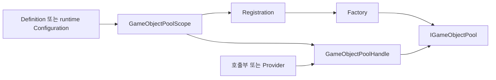

# GameObject Pooling: 설계와 동작

[English](Design.en.md) · [설치와 API 사용](../README.md)

## 해결하는 문제

Unity의 `ObjectPool<T>`는 재사용 저장소를 제공합니다. 게임에서 추가로 필요한 것은 Prefab 구성,
Component 접근, 외부 파괴 감지, 반환 시 상태 복원, 그리고 Scene·Application·owner에 따른 풀 종료입니다.
이 패키지는 저장소는 Unity API에 맡기고 이 수명·구성 계약을 추가합니다.

## 책임과 호출 흐름

| 타입 | 책임 | 호출부가 알아야 할 것 |
| --- | --- | --- |
| `UnityGameObjectPoolDefinition` | Inspector에서 공유하는 Prefab·풀·수명 설정 | 런타임 상태를 에셋에 저장하지 않음 |
| `GameObjectPoolScope` | 등록과 수명 관리의 진입점 | 기본 풀 또는 등록한 Handle을 사용 |
| `GameObjectPoolHandle` | 특정 풀의 Spawn/Despawn | 종료 뒤 `IsValid == false` |
| `ComponentPoolProvider<T>` | 프로젝트의 도메인 API로 접근 제한 | 풀을 별도로 소유하지 않음 |
| `IGameObjectPoolFactory` | 설정에 맞는 풀 생성 | 사용자 풀 구현의 확장 지점 |
| `IPoolLifetimeHandler` | 수명 정책 실행 | Scope에 등록하면 Scope가 Dispose 책임을 가짐 |

Definition 기반 등록은 같은 Scope에서 공유 Handle을 사용하고, runtime Configuration 등록은
독립 Handle을 만듭니다. Catalog는 여러 Definition의 등록·preload를 묶는 선택 사항입니다.
Catalog를 게임 로직의 전역 검색 키로 사용하지 않습니다.

## 한 번의 재사용 주기

1. `Spawn`이 비활성 저장소에서 객체를 얻고 위치·회전·부모를 적용합니다.
2. 활성 목록에 등록하고 `SetActive(true)` 후 `IPoolGetHandler`를 호출합니다.
3. 사용을 마치면 같은 Handle의 `Despawn`에 반환합니다.
4. `IPoolReleaseHandler` 호출 후 설정에 따라 `[ResetOnPoolRelease]` 멤버를 복원합니다.
5. 객체를 비활성화하고 풀 루트로 옮긴 뒤 저장소에 반환합니다.

수명 훅 검색은 생성 시 루트 GameObject의 컴포넌트를 대상으로 합니다. 자식의 훅을 자동 호출한다고
가정하지 마세요. `Spawn<T>`는 Prefab 루트에 T가 없으면 예외를 던집니다.

## 기본값과 종료 정책

runtime `UnityGameObjectPoolConfiguration`의 기본값은 prewarm 0, capacity 10, 최대 비활성 100,
collection check 켬, Attribute 상태 복원 켬, 외부 파괴 `WarnAndReplace`, 활성 객체 종료 `Destroy`입니다.
최대 비활성 수는 전체 Spawn 수 제한이 아닙니다. 반환 시 저장 용량을 넘는 객체는 파괴됩니다.

Scope·Scene·Application 수명을 구분합니다. Application 수명에는 루트의 지속 Scope가 필요합니다.
`OwnerPoolLifetimeConfiguration`은 owner의 비활성화가 아닌 실제 파괴를 감지합니다.
종료 시 비활성 객체는 파괴됩니다. `Preserve` 정책은 활성 객체를 풀에서 분리하므로, 이후에는
호출부가 그 객체의 파괴를 책임져야 하며 종료된 Handle에 반환할 수 없습니다.

## 실패·비동기 계약

- 다른 풀의 객체, 이중 반환, null 반환은 정상 사용 경로가 아닙니다. 기본 구현은 예외로 알립니다.
- 종료된 Handle의 Spawn/Despawn은 `ObjectDisposedException`을 던집니다.
- 외부 `Destroy` 뒤의 처리 방식은 `DestroyedInstancePolicy`로 선택합니다. 정상 회수는 Despawn입니다.
- 비동기는 풀 등록·생성 단계에만 필요합니다. 등록 뒤 Spawn/Despawn은 동기 호출입니다.
- `RegisterAsync`는 비동기 Factory를 우선 사용하고 없으면 동기 Factory로 처리합니다.
  동기 `Register`는 비동기 결과를 블로킹해서 기다리지 않습니다.
- 사용자 Factory가 외부 로드 리소스를 획득했다면 반환한 풀의 Dispose에서 해제해야 합니다.

## 실행과 코드 읽기

Package Manager에서 Basic Usage를 Import하고 [샘플 안내](../Samples~/BasicUsage/README.md)를
따라 Scene의 Definition·runtime Configuration·Provider 예제를 비교하세요.
최소 호출은 [GameObjectPoolingSample](../Samples~/BasicUsage/GameObjectPoolingSample.cs),
도메인 경계는 [ProviderPoolingSample](../Samples~/BasicUsage/ProviderPoolingSample.cs)을 참고합니다.

코드는 [Scope](../Runtime/Scopes/GameObjectPoolScope.cs) →
[Handle](../Runtime/Handles/GameObjectPoolHandle.cs) →
[기본 Pool](../Runtime/Pools/UnityGameObjectPool.cs) 순서로 읽으면 됩니다.
[테스트](../Tests)는 종료·반환·외부 파괴 등의 회귀 사례를 제공합니다.
소비 프로젝트 manifest의 `testables`에 패키지 ID를 추가해 Unity Test Runner로 실행합니다.
