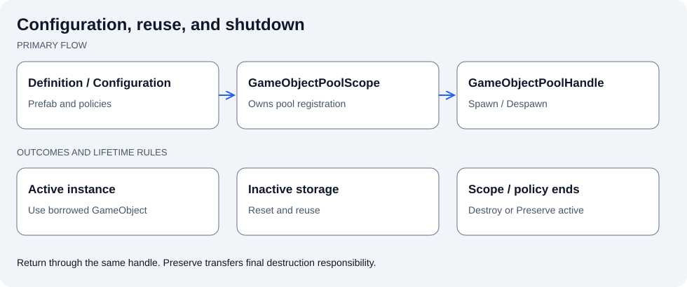

# Jeomseon Unity GameObject Pooling

[한국어](README.md) | English

Separates Prefab reuse configuration, access, return, and shutdown. Unity ObjectPool supplies storage; the package adds GameObject lifetime policies.



Keep configuration in the Definition/Configuration, registration and shutdown in the Scope, and reuse calls on the Handle. Stop using an instance after returning it.

## Quick start

Register a Definition or runtime Configuration in a Scope, Spawn through its Handle, Despawn through the same Handle, then let the Scope/policy shut down the pool. Domain Providers are optional.

Complete sample: [GameObjectPoolingSample.cs](Samples~/BasicUsage/GameObjectPoolingSample.cs).

```csharp
using Jeomseon.Unity.GameObjectPooling.Contracts;
using Jeomseon.Unity.GameObjectPooling.Scopes;
using UnityEngine;
using UnityEngine.Serialization;

namespace Jeomseon.Samples.GameObjectPooling
{
    /// <summary>
    /// Demonstrates concise Definition-based access through a scene scope's default handle.
    /// 씬 Scope의 기본 Handle을 통한 간결한 Definition 기반 접근을 보여줍니다.
    /// </summary>
    public sealed class GameObjectPoolingSample : MonoBehaviour
    {
        [SerializeField, FormerlySerializedAs("_scope")] private GameObjectPoolScope scope;
        private GameObject _instance;

        [ContextMenu("Get Pooled Object / 풀 객체 가져오기")]
        private void GetPooledObject()
        {
            if (_instance != null || scope == null) return;

            _instance = scope.Spawn(PoolSpawnOptions.At(
                transform.position,
                transform.rotation,
                transform));
        }

        [ContextMenu("Release Pooled Object / 풀 객체 반환하기")]
        private void ReleasePooledObject()
        {
            if (_instance == null || scope == null) return;

            scope.Despawn(_instance);
            _instance = null;
        }
    }
}
```

## Contracts and limitations

The inactive limit is not a total-spawn limit. Destroy preserved detached objects yourself. Put custom lifecycle handlers on the Prefab root.

## Requirements

- Unity `6000.6.0f1`
- Package: `com.jeomseon.unity.game-object-pooling` `0.4.0`

## Installation

Merge this into your project's `Packages/manifest.json`; preserve existing dependencies and registries.

```json
{
  "scopedRegistries": [
    {
      "name": "OpenUPM",
      "url": "https://package.openupm.com",
      "scopes": [
        "com.jeomseon"
      ]
    }
  ],
  "dependencies": {
    "com.jeomseon.unity.game-object-pooling": "0.4.0"
  }
}
```

Or use **Install package from git URL** in Package Manager:

```text
https://github.com/jeomseon0516/Unity.GameObjectPooling.git#v0.4.0
```

## Design and behavior

### Problem and boundaries

Unity `ObjectPool<T>` supplies reusable storage. This package adds Prefab configuration, Component
access, external-destruction policies, reset-on-return behavior, and Scope/Scene/Application/owner
lifetimes. Storage remains backed by Unity's pool API.

| Type | Responsibility | Consumer contract |
| --- | --- | --- |
| `UnityGameObjectPoolDefinition` | Shared Inspector configuration | Does not store runtime pool state |
| `GameObjectPoolScope` | Registration and lifetime entry point | Supplies the default or registered Handle |
| `GameObjectPoolHandle` | Spawn/Despawn for a particular pool | `IsValid` becomes false on shutdown |
| `ComponentPoolProvider<T>` | Project-specific domain access | Does not independently own the pool |
| `IGameObjectPoolFactory` | Creates pools from configuration | Extension point for custom implementations |
| `IPoolLifetimeHandler` | Executes lifetime policies | Ownership transfers to the registering Scope |

Definition registration shares a Handle within the same Scope. Runtime Configuration registration
creates independent Handles. A Catalog optionally batches registration/preload; it is not a global
lookup key for gameplay code. The flow is Configuration → Scope/Registration → Factory → Pool,
with consumers accessing the Pool through a Handle or domain Provider.

### Reuse and shutdown

1. Spawn obtains an inactive instance and applies parent/pose.
2. The instance is tracked as active, enabled, then receives `IPoolGetHandler` callbacks.
3. Return through the same Handle's Despawn.
4. `IPoolReleaseHandler` runs, followed by configured `[ResetOnPoolRelease]` restoration.
5. The instance is disabled, parented to the pool root, and returned to storage.

Lifecycle handlers are discovered on the root GameObject at creation. Child handlers are not
automatically invoked. `Spawn<T>` throws when the Prefab root does not contain T.

Runtime configuration defaults are prewarm 0, capacity 10, maximum inactive 100, collection checks
enabled, attribute reset enabled, `WarnAndReplace` for external destruction, and `Destroy` for
active instances on shutdown. The inactive limit is not a total-spawn limit; excess returns are destroyed.

Application lifetime requires a persistent root Scope. Owner lifetime ends on destruction, not
deactivation. Inactive instances are destroyed on shutdown. `Preserve` detaches active instances
from the pool; their new owner must destroy them and cannot return them through the invalid Handle.

### Failure and async behavior

- Foreign-pool objects, duplicate returns, and null returns are invalid and throw in the default pool.
- Spawn/Despawn on an invalid Handle throws `ObjectDisposedException`.
- External Destroy is handled by `DestroyedInstancePolicy`; use Despawn for normal returns.
- Async work belongs to registration/creation. Spawn and Despawn remain synchronous afterward.
- `RegisterAsync` prefers an async Factory, otherwise uses a synchronous one. Synchronous Register
  never blocks waiting for an async Factory.
- A custom Factory's acquired loader resources must be released by the returned pool's Dispose.

### Run and inspect

Import Basic Usage in Package Manager and follow the [sample instructions](Samples~/BasicUsage/README.md).
Compare [minimal access](Samples~/BasicUsage/GameObjectPoolingSample.cs) with the
[Provider example](Samples~/BasicUsage/ProviderPoolingSample.cs).
Read [Scope](Runtime/Scopes/GameObjectPoolScope.cs),
[Handle](Runtime/Handles/GameObjectPoolHandle.cs), then
[Pool](Runtime/Pools/UnityGameObjectPool.cs).
[Tests](Tests) cover return, shutdown, and external destruction. Add the package ID to the
consumer manifest's `testables` and run Unity Test Runner.

## API usage and details

### Features

- Replaceable `IGameObjectPool`, `IGameObjectPoolFactory`, and runtime configuration contracts
- A default implementation backed by Unity `ObjectPool<GameObject>` and ScriptableObject definitions
- An inheritable `ComponentPoolProvider<T>` that does not create another storage
- Unity `GameObject` and `Component` object pools
- `ResetOnPoolReleaseAttribute` for restoring fields and properties on return

Regular call sites depend on a `GameObjectPoolHandle` returned by `GameObjectPoolScope`, or on a project-facing Provider. Definitions and runtime configurations both become registrations, separating creation input from runtime identity.

### GameObject pool setup

1. Create a definition from `Tool/GameObject Pooling/Unity GameObject Pool` and configure its prefab and policies.
2. Add `GameObjectPoolScope` to a scene GameObject and assign its default Definition.
3. Assign a Catalog only when multiple pools must be registered and preloaded together. A Catalog is not used as a runtime pool lookup key.

Each definition produces a shared registration from separate pool-construction and lifetime configurations. The scope processes the built-in `Scope`, `Scene`, and `Application` policies. Application lifetime requires a root scope with `Dont Destroy On Load` enabled.

Use the runtime-only `OwnerPoolLifetimeConfiguration` when a scene object owns a pool. A
GameObject or Component can be the owner, and the pool is released only after actual
destruction, not when the owner is disabled. The same owner can manage multiple pools. Scene
object references are intentionally not stored in ScriptableObject Definitions.

```csharp
GameObjectPoolHandle ownedHandle = scope.Register(
    poolConfiguration,
    new OwnerPoolLifetimeConfiguration(this));
```

A registration can also be created in code without a ScriptableObject. Runtime registrations return independent handles, while a Definition resolves a shared handle within one scope.

```csharp
var poolConfiguration =
    new UnityGameObjectPoolConfiguration(prefab, "Runtime Enemies");
GameObjectPoolHandle handle = scope.Register(
    poolConfiguration,
    PoolLifetimeConfiguration.Scene);

Enemy enemy = handle.Spawn<Enemy>(options);
handle.Despawn(enemy);
```

Project-specific Mesh, Material, and Texture variants remain a `ComponentPoolProvider<T>` extension concern. Prefer separate prefab variants and definitions for fixed variants.

Choose the access layer by purpose. `Scope.Spawn/Despawn` is a convenience API for one
default pool, `GameObjectPoolHandle` is the normal explicit pool access, and
`ComponentPoolProvider<T>` is an optional project or domain adapter. In Play Mode, the Scope
Inspector reports every registered Handle, including runtime registrations outside a Catalog.

For finished projects, prefer a domain-specific Provider interface and implementation in
gameplay code. A Provider receives only a scope-owned `GameObjectPoolHandle` and does not own
the pool directly. `GameObjectPoolService`, factories, and `IGameObjectPool` remain public
low-level APIs for custom storage and composition roots.

#### Synchronous and asynchronous creation

Consumers select the synchronous or `Awaitable`-based API according to the resource source.
Once registration completes, both paths use the same synchronous `Spawn` and `Despawn`
operations.

```csharp
GameObjectPoolHandle immediate = scope.Register(definition);
GameObjectPoolHandle loaded = await scope.RegisterAsync(
    definition,
    destroyCancellationToken);
```

Coroutine- or event-oriented code can use the callback convenience API over the same async
path. The callback runs exactly once on the main thread and receives success, cancellation,
or failure through one `PoolRegistrationResult`.

```csharp
scope.RegisterAsync(
    definition,
    result =>
    {
        if (result.IsCanceled) return;
        if (result.IsFailed)
        {
            Debug.LogException(result.Exception);
            return;
        }

        GameObjectPoolHandle handle = result.Handle;
    },
    destroyCancellationToken);
```

`RegisterAsync` prefers a matching `IAsyncGameObjectPoolFactory` and falls back to a
synchronous `IGameObjectPoolFactory`. `Register` never blocks on an asynchronous factory
through `.Wait()`, `.Result`, or `GetAwaiter().GetResult()`.

Addressables and network integration packages implement `IAsyncGameObjectPoolFactory`.
Ownership of external load handles and resources moves to the returned `IGameObjectPool`,
whose `Dispose` releases them. The core GameObject Pooling package does not directly reference a
specific loader type.

For a project-specific lifetime, store policy data in `IPoolLifetimeConfiguration`, implement
its execution in `IPoolLifetimeHandler`, and register the handler with a Scope. The Scope takes
ownership and disposes the handler on shutdown; the latest compatible handler takes precedence.
An existing shared Handle keeps its initially selected handler. Custom handlers must be registered
again after shutdown and reinitialization, and `Validate` must remain free of side effects.

```csharp
scope.RegisterLifetimeHandler(new RoundLifetimeHandler(roundService));

GameObjectPoolHandle handle = scope.Register(
    poolConfiguration,
    new RoundLifetimeConfiguration(roundId));
```

| API level | Primary types | Purpose |
| --- | --- | --- |
| Convenience | `Scope.Spawn/Despawn` | One default pool and prototypes |
| Standard | Scope, Handle, Definition | Explicit registration and use |
| Project boundary | Domain Provider | Recommended dependency for finished gameplay |
| Extension | Registration, Configuration, Lifetime Handler | Creation and lifetime policies |
| Low-level | Service, Factory, `IGameObjectPool` | Custom storage and composition roots |

The `Basic Usage` sample includes Definition-based access, runtime-configuration access, project-facing Provider access, and a manual Application-lifetime verification environment.

## Verify the behavior

1. Import Basic Usage and open `GameObjectPooling/GameObjectPoolingSample.unity`.
2. In Play Mode, invoke the Get/Release context menus on 01 Definition Access. After return, check that the instance becomes inactive and moves under the pool root.
3. Get again to observe reuse, then compare the same calling flow with 02 Runtime Configuration.
4. Compare active-instance Destroy/Preserve shutdown policies. Explicitly destroy instances detached by Preserve.

## Samples

Import the desired entry from **Package Manager > Samples**. Use the included Scene/Editor tool and complete its Setup step first, if required.

- [Basic Usage](Samples~/BasicUsage/README.md)
  - [GameObjectPoolingSample](Samples~/BasicUsage/GameObjectPooling/GameObjectPoolingSample.unity)

## Tests

[Test sources](Tests)

Add the package ID to manifest `testables`, then execute its relevant EditMode/PlayMode assemblies in Unity Test Runner.

## Further reading

[Complete source map and package metadata](Documentation~/Overview.en.md)
- [Changelog](CHANGELOG.md)

## License

[License](LICENSE.md)
