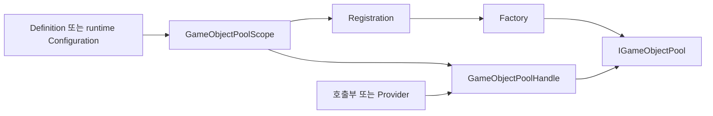

# Jeomseon Unity GameObject Pooling

한국어 | [English](README.en.md)

Prefab 재사용의 설정·접근·반환·풀 종료를 분리합니다. Unity ObjectPool을 저장소로 사용하고 게임 객체 수명 정책을 추가합니다.

## 빠르게 시작하기

Definition 또는 runtime Configuration을 Scope에 등록 → Handle로 Spawn → 같은 Handle에 Despawn → Scope/정책 종료로 풀 정리. 도메인 Provider는 선택 사항입니다.

전체 샘플 코드: [GameObjectPoolingSample.cs](Samples~/BasicUsage/GameObjectPoolingSample.cs).

```csharp
using Jeomseon.Unity.GameObjectPooling.Contracts;
using Jeomseon.Unity.GameObjectPooling.Scopes;
using UnityEngine;
using UnityEngine.Serialization;

namespace Jeomseon.Samples.GameObjectPooling
{
    /// <summary>
    /// Demonstrates concise Definition-based access through a scene scope's default handle.
    /// 씬 Scope의 기본 Handle을 통한 간결한 Definition 기반 접근을 보여줍니다.
    /// </summary>
    public sealed class GameObjectPoolingSample : MonoBehaviour
    {
        [SerializeField, FormerlySerializedAs("_scope")] private GameObjectPoolScope scope;
        private GameObject _instance;

        [ContextMenu("Get Pooled Object / 풀 객체 가져오기")]
        private void GetPooledObject()
        {
            if (_instance != null || scope == null) return;

            _instance = scope.Spawn(PoolSpawnOptions.At(
                transform.position,
                transform.rotation,
                transform));
        }

        [ContextMenu("Release Pooled Object / 풀 객체 반환하기")]
        private void ReleasePooledObject()
        {
            if (_instance == null || scope == null) return;

            scope.Despawn(_instance);
            _instance = null;
        }
    }
}
```

## 계약과 주의사항

최대 비활성 수는 전체 생성 수 제한이 아닙니다. Preserve로 분리한 객체는 직접 파괴해야 합니다. 사용자 수명 훅은 루트 컴포넌트에 둡니다.

## 요구 사항

- Unity `6000.6.0f1`
- 패키지: `com.jeomseon.unity.game-object-pooling` `0.4.0`

## 설치

프로젝트 `Packages/manifest.json`의 기존 dependencies와 registry를 유지하면서 다음 항목을 병합합니다.

```json
{
  "scopedRegistries": [
    {
      "name": "OpenUPM",
      "url": "https://package.openupm.com",
      "scopes": [
        "com.jeomseon"
      ]
    }
  ],
  "dependencies": {
    "com.jeomseon.unity.game-object-pooling": "0.4.0"
  }
}
```

또는 Package Manager의 **Install package from git URL**을 사용합니다:

```text
https://github.com/jeomseon0516/Unity.GameObjectPooling.git#v0.4.0
```

## 설계와 동작

### 해결하는 문제

Unity의 `ObjectPool<T>`는 재사용 저장소를 제공합니다. 게임에서 추가로 필요한 것은 Prefab 구성,
Component 접근, 외부 파괴 감지, 반환 시 상태 복원, 그리고 Scene·Application·owner에 따른 풀 종료입니다.
이 패키지는 저장소는 Unity API에 맡기고 이 수명·구성 계약을 추가합니다.

### 책임과 호출 흐름



| 타입 | 책임 | 호출부가 알아야 할 것 |
| --- | --- | --- |
| `UnityGameObjectPoolDefinition` | Inspector에서 공유하는 Prefab·풀·수명 설정 | 런타임 상태를 에셋에 저장하지 않음 |
| `GameObjectPoolScope` | 등록과 수명 관리의 진입점 | 기본 풀 또는 등록한 Handle을 사용 |
| `GameObjectPoolHandle` | 특정 풀의 Spawn/Despawn | 종료 뒤 `IsValid == false` |
| `ComponentPoolProvider<T>` | 프로젝트의 도메인 API로 접근 제한 | 풀을 별도로 소유하지 않음 |
| `IGameObjectPoolFactory` | 설정에 맞는 풀 생성 | 사용자 풀 구현의 확장 지점 |
| `IPoolLifetimeHandler` | 수명 정책 실행 | Scope에 등록하면 Scope가 Dispose 책임을 가짐 |

Definition 기반 등록은 같은 Scope에서 공유 Handle을 사용하고, runtime Configuration 등록은
독립 Handle을 만듭니다. Catalog는 여러 Definition의 등록·preload를 묶는 선택 사항입니다.
Catalog를 게임 로직의 전역 검색 키로 사용하지 않습니다.

### 한 번의 재사용 주기

1. `Spawn`이 비활성 저장소에서 객체를 얻고 위치·회전·부모를 적용합니다.
2. 활성 목록에 등록하고 `SetActive(true)` 후 `IPoolGetHandler`를 호출합니다.
3. 사용을 마치면 같은 Handle의 `Despawn`에 반환합니다.
4. `IPoolReleaseHandler` 호출 후 설정에 따라 `[ResetOnPoolRelease]` 멤버를 복원합니다.
5. 객체를 비활성화하고 풀 루트로 옮긴 뒤 저장소에 반환합니다.

수명 훅 검색은 생성 시 루트 GameObject의 컴포넌트를 대상으로 합니다. 자식의 훅을 자동 호출한다고
가정하지 마세요. `Spawn<T>`는 Prefab 루트에 T가 없으면 예외를 던집니다.

### 기본값과 종료 정책

runtime `UnityGameObjectPoolConfiguration`의 기본값은 prewarm 0, capacity 10, 최대 비활성 100,
collection check 켬, Attribute 상태 복원 켬, 외부 파괴 `WarnAndReplace`, 활성 객체 종료 `Destroy`입니다.
최대 비활성 수는 전체 Spawn 수 제한이 아닙니다. 반환 시 저장 용량을 넘는 객체는 파괴됩니다.

Scope·Scene·Application 수명을 구분합니다. Application 수명에는 루트의 지속 Scope가 필요합니다.
`OwnerPoolLifetimeConfiguration`은 owner의 비활성화가 아닌 실제 파괴를 감지합니다.
종료 시 비활성 객체는 파괴됩니다. `Preserve` 정책은 활성 객체를 풀에서 분리하므로, 이후에는
호출부가 그 객체의 파괴를 책임져야 하며 종료된 Handle에 반환할 수 없습니다.

### 실패·비동기 계약

- 다른 풀의 객체, 이중 반환, null 반환은 정상 사용 경로가 아닙니다. 기본 구현은 예외로 알립니다.
- 종료된 Handle의 Spawn/Despawn은 `ObjectDisposedException`을 던집니다.
- 외부 `Destroy` 뒤의 처리 방식은 `DestroyedInstancePolicy`로 선택합니다. 정상 회수는 Despawn입니다.
- 비동기는 풀 등록·생성 단계에만 필요합니다. 등록 뒤 Spawn/Despawn은 동기 호출입니다.
- `RegisterAsync`는 비동기 Factory를 우선 사용하고 없으면 동기 Factory로 처리합니다.
  동기 `Register`는 비동기 결과를 블로킹해서 기다리지 않습니다.
- 사용자 Factory가 외부 로드 리소스를 획득했다면 반환한 풀의 Dispose에서 해제해야 합니다.

### 실행과 코드 읽기

Package Manager에서 Basic Usage를 Import하고 [샘플 안내](Samples~/BasicUsage/README.md)를
따라 Scene의 Definition·runtime Configuration·Provider 예제를 비교하세요.
최소 호출은 [GameObjectPoolingSample](Samples~/BasicUsage/GameObjectPoolingSample.cs),
도메인 경계는 [ProviderPoolingSample](Samples~/BasicUsage/ProviderPoolingSample.cs)을 참고합니다.

코드는 [Scope](Runtime/Scopes/GameObjectPoolScope.cs) →
[Handle](Runtime/Handles/GameObjectPoolHandle.cs) →
[기본 Pool](Runtime/Pools/UnityGameObjectPool.cs) 순서로 읽으면 됩니다.
[테스트](Tests)는 종료·반환·외부 파괴 등의 회귀 사례를 제공합니다.
소비 프로젝트 manifest의 `testables`에 패키지 ID를 추가해 Unity Test Runner로 실행합니다.

## API 사용과 상세 설명

### 포함 기능

- 사용자 구현으로 교체 가능한 `IGameObjectPool`, `IGameObjectPoolFactory` 및 런타임 Configuration 계약
- Unity `ObjectPool<GameObject>` 기반 기본 구현과 ScriptableObject 풀 정의
- 별도 저장소를 만들지 않는 상속 가능 `ComponentPoolProvider<T>`
- Unity `GameObject` 및 `Component` 오브젝트 풀
- 풀 반환 시 필드와 프로퍼티를 복원하는 `ResetOnPoolReleaseAttribute`

일반 호출부는 `GameObjectPoolScope`가 반환한 `GameObjectPoolHandle` 또는 프로젝트 Provider에 의존합니다. Definition과 런타임 Configuration은 모두 Registration으로 변환되므로 생성 방식과 런타임 식별이 분리됩니다.

### GameObject 풀 설정

1. `Tool/GameObject Pooling/Unity GameObject Pool`에서 Definition을 만들고 Prefab과 정책을 설정합니다.
2. 씬의 GameObject에 `GameObjectPoolScope`를 추가하고 기본 Definition을 연결합니다.
3. 여러 풀을 일괄 등록하고 Preload해야 할 때만 선택적으로 Catalog를 연결합니다. Catalog는 런타임 풀 조회 키로 사용되지 않습니다.

Definition은 풀 생성 Configuration과 수명 Configuration으로 공유 Registration을 만듭니다. Scope는 `PoolLifetimeConfiguration`의 `Scope`, `Scene`, `Application` 정책을 처리하며, `Application` 수명은 `Dont Destroy On Load`가 활성화된 루트 Scope에서만 사용할 수 있습니다.

Scene 객체가 풀을 소유해야 할 때는 런타임 전용 `OwnerPoolLifetimeConfiguration`을
사용합니다. GameObject 또는 Component를 소유자로 지정할 수 있고, 비활성화가 아니라 실제로
파괴된 뒤 풀을 해제합니다. 같은 소유자를 여러 풀에 지정할 수 있으며 Scene 객체 참조는
ScriptableObject Definition에 저장하지 않습니다.

```csharp
GameObjectPoolHandle ownedHandle = scope.Register(
    poolConfiguration,
    new OwnerPoolLifetimeConfiguration(this));
```

ScriptableObject 없이 코드에서 Registration을 만들 수도 있습니다. 런타임 등록은 독립 Handle을 반환하며 Definition 등록은 같은 Scope에서 공유 Handle을 반환합니다.

```csharp
var poolConfiguration =
    new UnityGameObjectPoolConfiguration(prefab, "Runtime Enemies");
GameObjectPoolHandle handle = scope.Register(
    poolConfiguration,
    PoolLifetimeConfiguration.Scene);

Enemy enemy = handle.Spawn<Enemy>(options);
handle.Despawn(enemy);
```

Mesh, Material, Texture 같은 프로젝트별 Variant 적용은 `ComponentPoolProvider<T>` 사용자 확장 영역입니다. 고정된 Variant는 Prefab Variant와 별도 Definition을 사용하는 것을 권장합니다.

접근 계층은 용도에 따라 선택합니다. `Scope.Spawn/Despawn`은 단일 기본 풀 편의 API,
`GameObjectPoolHandle`은 일반적인 명시적 풀 접근, `ComponentPoolProvider<T>`는 선택적인
프로젝트·도메인 어댑터입니다. Play Mode의 Scope Inspector는 Catalog 여부와 관계없이
Definition 및 런타임 Configuration으로 등록된 모든 Handle의 통계를 표시합니다.

완성된 프로젝트의 게임 로직에서는 도메인별 Provider 인터페이스와 구현을 두는 것을
권장합니다. Provider는 Scope가 소유한 `GameObjectPoolHandle`만 전달받으며 Pool을 직접
소유하지 않습니다. `GameObjectPoolService`, Factory 및 `IGameObjectPool`은 사용자 저장소나
Composition Root를 구현하는 저수준 확장 API입니다.

#### 동기 및 비동기 생성

호출부는 리소스 공급 방식에 따라 동기 또는 `Awaitable` 기반 API를 선택합니다. 등록이
완료된 뒤의 `Spawn`과 `Despawn`은 두 경로 모두 동일한 동기 API를 사용합니다.

```csharp
GameObjectPoolHandle immediate = scope.Register(definition);
GameObjectPoolHandle loaded = await scope.RegisterAsync(
    definition,
    destroyCancellationToken);
```

Coroutine나 이벤트 중심 코드에서는 동일한 비동기 경로의 Callback 편의 API를 사용할 수
있습니다. Callback은 메인 스레드에서 정확히 한 번 호출되며 성공·취소·실패가 하나의
`PoolRegistrationResult`로 전달됩니다.

```csharp
scope.RegisterAsync(
    definition,
    result =>
    {
        if (result.IsCanceled) return;
        if (result.IsFailed)
        {
            Debug.LogException(result.Exception);
            return;
        }

        GameObjectPoolHandle handle = result.Handle;
    },
    destroyCancellationToken);
```

`RegisterAsync`는 지원하는 `IAsyncGameObjectPoolFactory`를 우선 선택하고, 없으면 동기
`IGameObjectPoolFactory`로 fallback합니다. 반대로 `Register`는 비동기 Factory를 기다리지
않으며 `.Wait()`, `.Result` 또는 `GetAwaiter().GetResult()`로 블로킹하지 않습니다.

Addressables나 네트워크 연동 패키지는 `IAsyncGameObjectPoolFactory`를 구현합니다. 외부
로드 핸들과 리소스의 소유권은 Factory가 반환하는 `IGameObjectPool` 구현으로 이전하고,
그 Pool의 `Dispose`에서 Addressables `Release`나 네트워크 리소스 해제를 수행해야 합니다.
GameObject Pooling 핵심 패키지는 특정 로더 타입을 직접 참조하지 않습니다.

프로젝트별 수명주기는 `IPoolLifetimeConfiguration`에 정책 데이터를 두고
`IPoolLifetimeHandler`에 실행 로직을 구현한 뒤 Scope에 등록합니다. Scope는 Handler의
소유권을 넘겨받아 종료 시 Dispose하며, 나중에 등록한 호환 Handler를 우선 선택합니다.
이미 생성된 공유 Handle은 최초 선택된 Handler를 계속 사용합니다. `Shutdown` 후 재초기화할
때는 사용자 Handler를 다시 등록해야 하며 `Validate`는 부작용 없이 구현해야 합니다.

```csharp
scope.RegisterLifetimeHandler(new RoundLifetimeHandler(roundService));

GameObjectPoolHandle handle = scope.Register(
    poolConfiguration,
    new RoundLifetimeConfiguration(roundId));
```

| API 수준 | 주요 타입 | 용도 |
| --- | --- | --- |
| 편의 | `Scope.Spawn/Despawn` | 단일 기본 풀과 프로토타입 |
| 일반 | Scope, Handle, Definition | 명시적인 풀 등록과 사용 |
| 프로젝트 경계 | 도메인별 Provider | 완성된 게임 로직의 권장 의존성 |
| 확장 | Registration, Configuration, Lifetime Handler | 생성·수명 정책 확장 |
| 저수준 | Service, Factory, `IGameObjectPool` | 사용자 저장소와 Composition Root |

`Basic Usage` 샘플에는 Definition 접근, 런타임 Configuration 접근, 프로젝트 Provider를 통한 간접 접근, Application 수명 수동 검증 환경이 포함됩니다.

## 샘플 실행

**Package Manager > Samples**에서 예제를 Import합니다. 포함된 Scene 또는 Editor 도구를 열고 필요한 Setup 메뉴를 먼저 실행합니다.

- [Basic Usage](Samples~/BasicUsage/README.md)
  - [GameObjectPoolingSample](Samples~/BasicUsage/GameObjectPooling/GameObjectPoolingSample.unity)

## 테스트

[테스트 코드](Tests)

manifest의 `testables`에 패키지 ID를 추가하고 Unity Test Runner의 관련 EditMode/PlayMode 어셈블리를 실행합니다.

## 추가 문서

[전체 코드 지도와 패키지 구성](Documentation~/Overview.md)
- [Changelog](CHANGELOG.md)

## 라이선스

[License](LICENSE.md)
